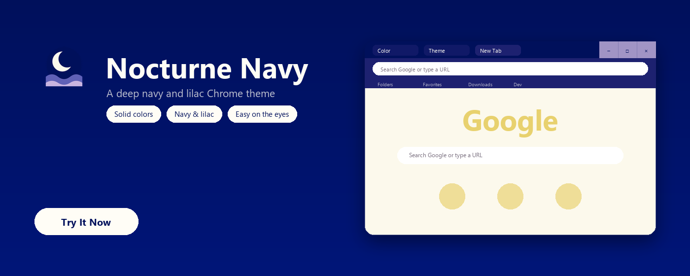
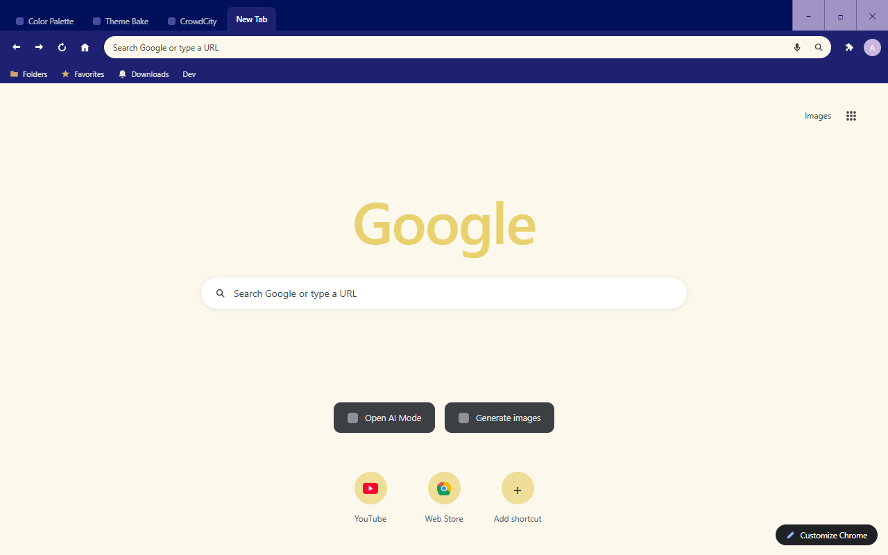
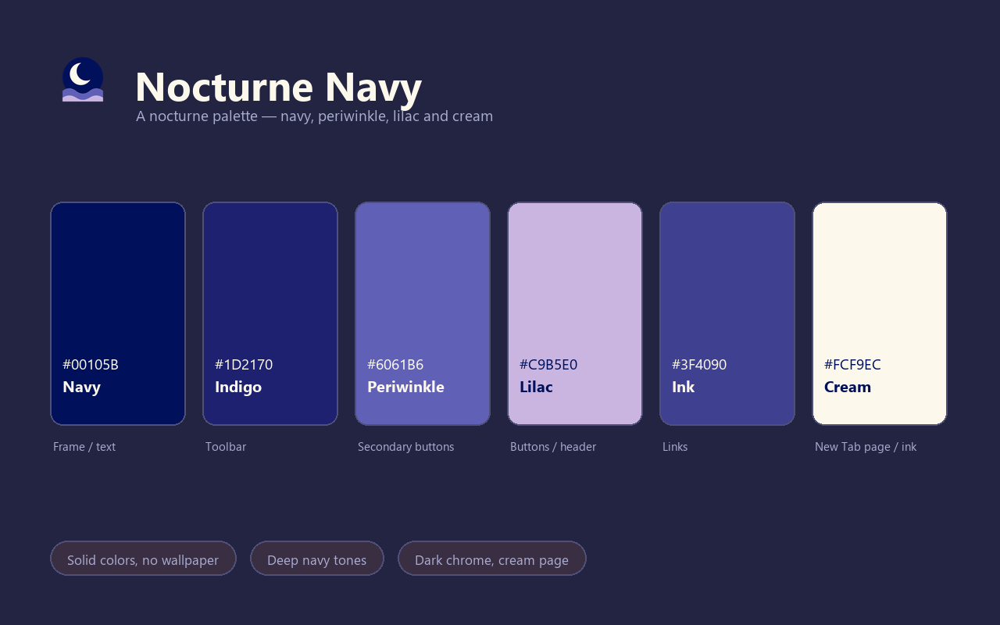

<p align="center">
  
</p>

<h1 align="center">Nocturne Navy Theme</h1>

<p align="center">
  A deep navy Chrome theme with periwinkle, lilac and a cream New Tab Page.
</p>

<p align="center">
  
  
  
  
</p>

<p align="center">
  
</p>

## Overview

Nocturne Navy is the blue hour in a window frame: a deep navy strip, a lifted indigo toolbar, and a cream New Tab Page where the Google mark glows warm gold. Cream ink keeps every tab, bookmark and toolbar icon readable on the dark chrome, periwinkle and lilac carry the buttons, and links fall back to a deep indigo so the page never shouts.

## Design Concept

The palette is one navy→indigo→lilac ramp plus a cream neutral, so the theme leans on lightness order rather than hue contrast:

1. **Three clearly separated surfaces** — navy frame `#00105B`, lifted indigo toolbar `#1D2170`, cream page `#FCF9EC`.
2. **One colour carries all the ink** — cream `#FCF9EC` on the dark chrome (≈17:1) and navy on the page (≈17:1).
3. **Accents stay small** — lilac only on buttons and the New Tab header, periwinkle on secondary buttons.

| Color | Hex | RGB | Role |
|---|---|---|---|
| Navy | `#00105B` | 0, 16, 91 | Frame / page text |
| Indigo | `#1D2170` | 29, 33, 112 | Toolbar |
| Periwinkle | `#6061B6` | 96, 97, 182 | Secondary buttons |
| Lilac | `#C9B5E0` | 201, 181, 224 | Buttons / New Tab header |
| Ink | `#3F4090` | 63, 64, 144 | New Tab links |
| Cream | `#FCF9EC` | 252, 249, 236 | New Tab background / chrome ink |

## Features

- Pure color, no wallpaper — fast and distraction-free
- Deep navy chrome with cream ink — 17:1 contrast
- Periwinkle and lilac accents, no gradient or wallpaper
- Tab text, bookmark text and toolbar icons all share the same cream ink
- Single-row shortcut row and a colour-matched Google mark for a clean New Tab Page
- No configuration needed — install and enjoy

## Screenshots

| Browser | Palette |
|:-:|:-:|
|  |  |

## Installation

### Load unpacked (development)

1. Download or clone this repository.
2. Open `chrome://extensions` in Chrome.
3. Enable **Developer mode** in the top right.
4. Click **Load unpacked** and select this folder (`nocturne-navy-theme`).
5. The theme is active immediately.

### Package for the Chrome Web Store

```
chrome://extensions → Pack extension → select this folder → nocturne-navy-theme.zip
```

Upload the resulting `.zip` to the [Chrome Web Store developer dashboard](https://chrome.google.com/webstore/devconsole).

## Store listing copy

Ready to paste into the store listing (also kept in `store-assets/store-description.txt`):

> Nocturne Navy is a deep navy Chrome theme: a navy frame, a lifted indigo toolbar, and a cream New Tab Page with a warm gold Google mark. Cream ink keeps every tab, bookmark and toolbar icon readable on the dark chrome, with periwinkle and lilac accents. Solid colors only, no wallpaper.

## Project structure

| File | Purpose |
|---|---|
| `manifest.json` | Theme definition (single-file, inlined `theme` field) |
| `logo/logo.png` | 128×128 store icon (transparent background) |
| `store-assets/promo/440x280.png` | Small promo tile |
| `store-assets/promo/1400x560.png` | Marquee promo tile |
| `store-assets/screenshots/en/screenshot-1-browser.png` | Browser mockup screenshot (1280×800) |
| `store-assets/screenshots/en/screenshot-2-palette.png` | Palette introduction screenshot (1280×800) |
| `store-assets/store-description.txt` | Store listing description |
| `scripts/generate-logo-vector.py` | Render all SVG logo candidates with headless Chromium, export `logo/logo.png` from `SELECTED` |
| `scripts/generate-screenshot-headless.py` | Regenerate the browser mockup via Playwright |
| `scripts/generate-screenshot-2-palette.py` | Regenerate the palette screenshot |
| `scripts/generate-promo.py` | Regenerate both promo tiles (1400×560 window hero, 440×280 dot palette) |
| `LICENSE` | Non-Commercial License (English / 中文) |

## Regenerating assets

Every asset is code-generated, so nothing here is hand-drawn or hand-copied:

```bash
py -3 scripts/generate-logo-vector.py         # candidates + logo/logo.png
py -3 scripts/generate-screenshot-headless.py # store screenshot 1 (browser mockup)
py -3 scripts/generate-screenshot-2-palette.py # store screenshot 2 (palette)
py -3 scripts/generate-promo.py               # promo 440x280 + 1400x560
```

To ship a different icon candidate, change `SELECTED` at the top of `generate-logo-vector.py` and re-run, then re-run the three asset scripts so the promo and screenshots pick up the new logo.

## License

Nocturne Navy Theme is released under the Non-Commercial License. See `LICENSE` for full text (English / 中文).
